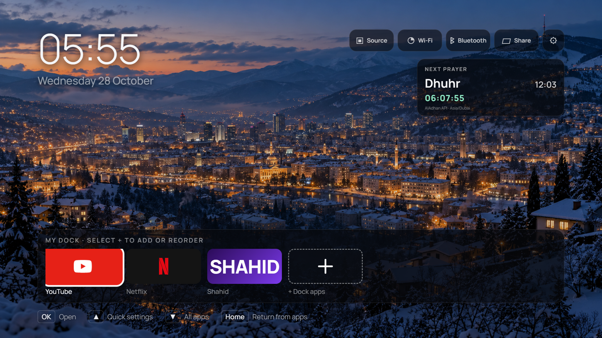

# Samsung Tizen Dashboard

A clean, remote-friendly dashboard for Samsung Tizen TVs. It replaces a wall of recommendations
with a customizable app dock, installed-app browser, HDMI/source shortcut, clock styles,
multilingual UI, rotating wallpapers, and a screen saver.




> This is an ordinary Samsung TV developer application—not a system launcher, firmware patch, or
> root modification. Samsung keeps control of the physical Home and branded streaming buttons.
> The optional companion helper works around that restriction from a small always-on computer.

## Highlights

- One- or two-row app dock; add, remove, and reorder apps with the remote
- All installed apps on a separate screen
- HDMI/source button and Samsung Settings shortcuts
- Digital English, digital Arabic, and analog clocks
- English, Arabic (RTL), Bosnian, Spanish, French, German, and Turkish
- 25 offline Sarajevo photographs plus other sample wallpapers
- User photo upload from a phone/laptop; images are copied into the TV's IndexedDB
- Adjustable wallpaper rotation and screen saver
- Live next-prayer countdown with cached daily timings from the AlAdhan API
- Optional Home/Prime outcome redirect and power-on helper for Windows or Raspberry Pi
- No advertising, analytics, cloud account, or tracking

## Important limitations

- A consumer Samsung TV does not let a normal Tizen web app permanently replace Samsung Home.
- The physical Home and branded streaming buttons are not delivered to ordinary web apps.
- TV-only startup can sometimes work with **Settings → All Settings → General & Privacy → Start
  Screen Options → Autorun Last App**, but Samsung notes that support depends on the app.
- The companion helper observes the TV's local app API. It does not modify firmware or key maps.
- The local helper must remain powered and on the same LAN. A Pi Zero 2 W is sufficient.

## Try it in a browser

Requirements: Node.js 18 or newer.

```bash
npm run preview
```

Open `http://localhost:8080`. Browser mode uses a mock Tizen API, so app launching and HDMI
switching are simulated.

## Build the Tizen package

```bash
npm run build
```

The unsigned build appears in `dist/`. Samsung TVs require a developer package signed for the
target TV. Follow [the TV installation guide](docs/setup-tv.md); never commit author/distributor
certificates or signed packages.

The application ID is intentionally stable: `Arn0Lnchr0.Launcher`. Changing it breaks updates and
any helper configured to launch the existing ID.

## Customize privately

Copy `src/js/config.local.example.js` to `src/js/config.local.js`. The real file is ignored by Git.
Use it for the private photo-server URL/PIN, weather/prayer coordinates, and per-TV overrides.

To enable prayer times, set `prayer.enabled`, coordinates, calculation `method`, and `school` in
the private override. The dashboard downloads today and tomorrow's schedules, refreshes them
periodically, and counts down locally every second. Cached schedules remain available during a
temporary internet outage. Calculation methods can differ from a mosque or government timetable;
use the method and optional minute adjustments appropriate for your area.

The built-in Sarajevo collection is ready immediately. To make another offline collection:

```bash
node scripts/prepare-wallpapers.mjs path/to/your/photos
```

Only publish photos you own or have permission to redistribute. See
[`src/CREDITS-SARAJEVO.md`](src/CREDITS-SARAJEVO.md) for the bundled Sarajevo sources and licences.

## Optional companion helper

The helper has two independent parts:

1. `watch_buttons.py` watches selected app transitions and asks the TV to launch the dashboard.
2. `photo_server.py` provides a PIN-protected photo inbox on your home network.

Copy `button-redirect/config.example.toml` to `button-redirect/config.toml`, change the TV address,
choose a strong PIN, and verify the regional app IDs. Real configuration, tokens, uploads, logs,
MAC addresses, and IP addresses are excluded from Git.

- [Windows and Raspberry Pi setup](button-redirect/README.md)

## Remote controls

| Key | Action |
| --- | --- |
| Arrows | Move focus |
| OK | Open/select |
| Back | Return one screen |
| Red | All apps |
| Green | Next wallpaper |
| Yellow | Toggle system apps in All Apps |
| Blue | Diagnostics/Lab |

## Privacy and safety

- The dashboard contains no telemetry.
- Open-Meteo is contacted only if weather coordinates are configured. AlAdhan is contacted only
  if prayer times are enabled; the configured coordinates and calculation options are sent to it.
- The photo inbox is LAN-only by design; do not expose port 8096 to the internet.
- A Samsung remote-control token authorizes remote actions. Keep `tokens.json` private.
- Do not commit signing certificates. Anyone holding the author key can impersonate an update.
- No root, bootloader unlock, firmware modification, or service-menu changes are required.

## Project layout

```text
src/                    Files packaged into the Tizen app
button-redirect/        Optional Windows/Pi helper and examples
docs/                   Installation notes and preview
scripts/                Build, preview, asset, and QA utilities
native/                 Experimental guarded reference helpers; read docs before use
```

## Credits and licence

The application code and documentation are MIT licensed; see [LICENSE](LICENSE). Bundled fonts,
photos, and brand marks retain their own licences and attribution files. Brand names and logos
belong to their owners.

This project derives from [NelsonEU/arn0-tv](https://github.com/NelsonEU/arn0-tv) and preserves its
MIT notice. The Sarajevo images are individually credited in
[`src/CREDITS-SARAJEVO.md`](src/CREDITS-SARAJEVO.md). This project is independent and is not
affiliated with Samsung or any streaming service.
